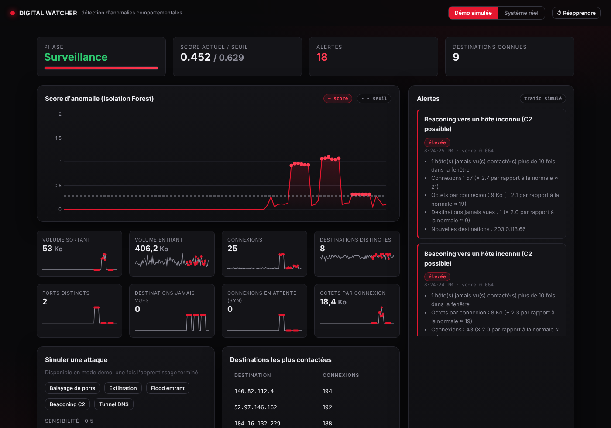

# 🛡 Digital Watcher

> Apprend le comportement habituel d'un réseau et signale en temps réel les activités inhabituelles, avec une explication lisible pour chaque alerte.



## Fonctionnement
1. **Apprentissage** : pendant les premières fenêtres, l'outil observe le trafic « normal ».
2. **Modélisation** : chaque fenêtre est résumée en 8 caractéristiques (volumes entrant et sortant, connexions, destinations et ports distincts, destinations jamais vues, connexions SYN en attente, octets par connexion), passées en échelle logarithmique.
3. **Détection hybride** :
   - un **Isolation Forest** (scikit-learn) note l'étrangeté de la combinaison,
   - un **écart robuste par caractéristique** (z-score) empêche la saturation de la forêt sur les valeurs extrêmes,
   - une **règle** signale un hôte inconnu contacté en rafale (beaconing).
4. **Explication** : l'alerte précise ce qui a changé (« Volume sortant : 66 991 Ko, × 1 738 par rapport à la normale ») et propose une hypothèse : balayage de ports, exfiltration, flood, tunnel DNS, beaconing C2…
5. **Adaptation** : les fenêtres jugées normales enrichissent la base et le modèle est réentraîné régulièrement.

## Deux sources
- **Démo simulée** : un poste de travail réaliste. On peut y injecter 5 attaques en un clic pour voir la détection fonctionner.
- **Système réel** (Linux) : connexions TCP lues dans `/proc/net/tcp*` et compteurs d'interfaces lus dans `/proc/net/dev`. Aucun privilège root n'est nécessaire.

La **sensibilité** est réglable en direct (elle déplace le seuil sur la distribution des scores d'apprentissage).

## Lancer
```bash
pip install -r requirements.txt
python app.py            # → http://127.0.0.1:5004
python -m pytest -q      # vérifie le taux de faux positifs et la détection de chaque attaque
```

## Pistes
- Ingestion de journaux (Zeek, NetFlow, journaux d'accès web)
- Une base de référence par heure de la journée (le trafic de 3 h ne ressemble pas à celui de 15 h)
- Notifications (webhook Discord / Slack) et export des alertes au format SIEM

## Licence
MIT © Jimo0x
